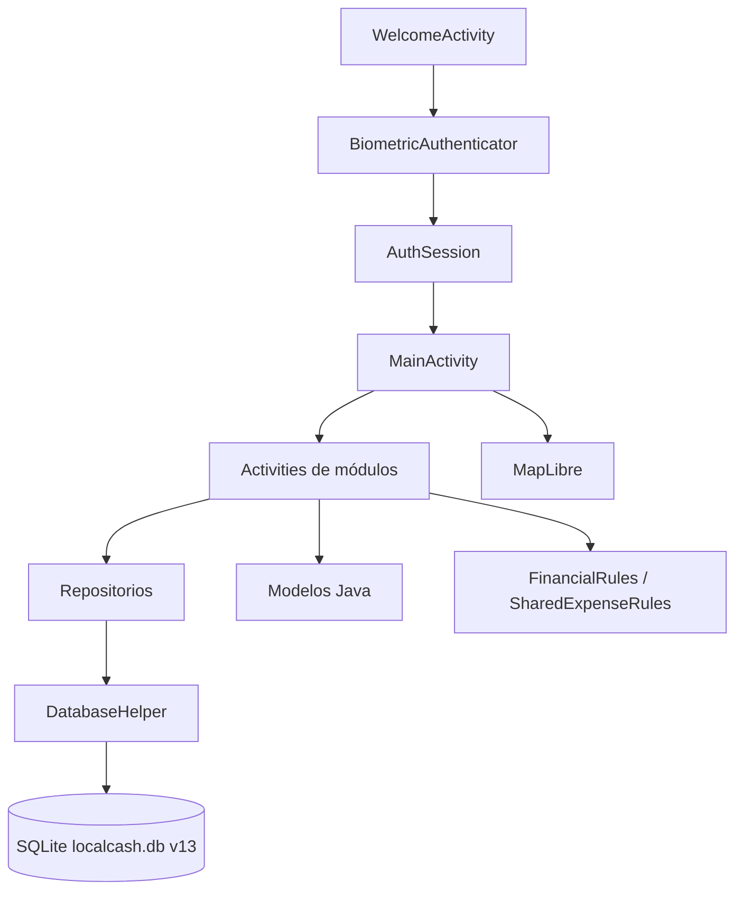
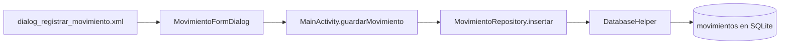
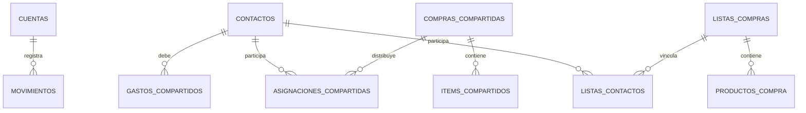

# Documentación técnica — LocalCash

## 1. Introducción y objetivo

LocalCash es una aplicación financiera móvil nativa para Android desarrollada con Java y XML. Su propósito es ayudar a registrar y consultar ingresos, gastos, cuentas financieras, compras planificadas, contactos y gastos compartidos, manteniendo los datos en una base SQLite privada del dispositivo.

La versión documentada corresponde al esquema **SQLite v13**. El diseño prioriza el funcionamiento local de las operaciones financieras y la privacidad de la información. La geolocalización de movimientos es opcional y el mapa es un complemento visual para consultar los registros que ya contienen coordenadas.

## 2. Arquitectura de la aplicación

LocalCash utiliza una arquitectura por capas ligera. Las `Activity` y los diálogos resuelven la presentación y la navegación; los repositorios concentran las consultas y escrituras SQLite; los modelos transportan datos; y las reglas puras validan cálculos financieros y divisiones de gastos.

No se utiliza un patrón MVVM ni un contenedor de inyección de dependencias. La separación observada en el código corresponde a presentación, reglas de negocio y persistencia mediante repositorios.



### Organización de paquetes

| Ubicación | Responsabilidad principal |
|---|---|
| `app/src/main/java/com/localcash/app` | Activities, navegación y pantallas de cada módulo. |
| `app/src/main/java/com/localcash/app/data` | `DatabaseHelper`, repositorios SQLite y utilidades de respaldo. |
| `app/src/main/java/com/localcash/app/model` | Modelos de dominio: cuentas, movimientos, contactos, compras y productos. |
| `app/src/main/java/com/localcash/app/ui` | Diálogos de formularios, autenticador biométrico y componentes de interfaz. |
| `app/src/main/java/com/localcash/app/security` | Sesión en memoria y base para Activities protegidas. |
| `app/src/main/java/com/localcash/app/util` | Validaciones y cálculos financieros sin dependencia de Android. |
| `app/src/main/java/com/localcash/app/map` | Configuración compartida del estilo de MapLibre. |
| `app/src/main/res` | Layouts XML, recursos visuales, textos, colores, temas y vectores. |

### Clases principales

| Clase | Responsabilidad |
|---|---|
| `WelcomeActivity` | Pantalla de entrada; solicita autenticación antes de abrir datos privados. |
| `MainActivity` | Panel financiero: resumen, movimientos recientes, filtro y accesos a módulos. |
| `ProtectedActivity` | Base para pantallas privadas; redirige a la bienvenida sin sesión autenticada. |
| `DatabaseHelper` | Crea y actualiza el esquema SQLite v13; habilita claves foráneas. |
| `MovimientoRepository` | CRUD de movimientos, historial y cálculo de resumen financiero. |
| `CuentaRepository` | Administración de cuentas y protección ante borrado de cuentas con movimientos. |
| `ListaCompraRepository` | Persistencia de listas, productos, estados y contactos asociados. |
| `GastoCompartidoRepository` | Registro de deudas simples y compras grupales detalladas. |
| `ContactoRepository` | Agenda local y validación de relaciones antes de eliminar un contacto. |
| `FinancialRules` y `SharedExpenseRules` | Validaciones de montos, productos, detalle y distribución de deudas. |

Las referencias anteriores se encuentran en `app/src/main/java/com/localcash/app/`, `data/`, `model/`, `security/`, `ui/` y `util/`.

### Ejemplo: flujo de registro de un gasto

El siguiente flujo describe las responsabilidades verificadas al guardar un gasto. Cada componente realiza una tarea específica; el diálogo no escribe directamente en SQLite.



1. `app/src/main/res/layout/dialog_registrar_movimiento.xml` define los campos visuales de tipo, descripción, monto, categoría, medio y cuenta.
2. `MovimientoFormDialog.validarYConfirmar()` recoge los valores y valida descripción, monto positivo, categoría para gastos, medio y cuenta compatible. Si todo es válido, construye un objeto `Movimiento` y lo entrega al listener.
3. `MainActivity.abrirFormularioMovimiento()` crea el diálogo y conecta su listener con `MainActivity.guardarMovimiento()`. Este método ejecuta la inserción fuera del hilo principal y actualiza el panel cuando termina correctamente.
4. `MovimientoRepository.insertar()` transforma el modelo en `ContentValues` e inserta la fila dentro de una transacción.
5. `DatabaseHelper` define la tabla `movimientos`, sus restricciones de tipo y monto, y la clave foránea `cuenta_id` hacia `cuentas`. SQLite conserva finalmente el registro en `localcash.db`.

## 3. Tecnologías y herramientas

| Tecnología | Uso en LocalCash |
|---|---|
| Android Studio | Entorno de desarrollo y sincronización Gradle. |
| Java 11 | Lógica de la aplicación. |
| XML | Interfaces, temas, textos, vectores y recursos. |
| SQLite / `SQLiteOpenHelper` | Persistencia privada local. |
| AndroidX y Material Components | Compatibilidad y controles de interfaz. |
| BiometricPrompt de Android | Autenticación mediante biometría del dispositivo. |
| MapLibre Native Android | Cartografía, marcadores de movimientos y descarga de regiones cartográficas. |
| JUnit 4 | Pruebas unitarias locales. |

## 4. Funcionalidades implementadas

### Seguridad y privacidad

- Pantalla de bienvenida antes de mostrar información financiera.
- Autenticación biométrica nativa con mensajes ante cancelación, ausencia de hardware o falta de huellas configuradas.
- Sesión sólo en memoria mediante `AuthSession`; no se persiste el acceso en disco.
- Invalidación de la sesión cuando Android informa que toda la interfaz quedó oculta.
- Actividades financieras y de contactos protegidas por `ProtectedActivity`.

### Cuentas, movimientos e historial

- Creación, edición, consulta y eliminación restringida de cuentas financieras.
- Registro de ingresos y gastos en pesos chilenos enteros, con cuenta, medio de pago o cobro, descripción, categoría, fecha y ubicación opcional.
- Cálculo de ingresos, gastos y saldo desde los movimientos almacenados.
- Filtro de movimientos por tipo y consulta de historial completo por cuenta y tipo.
- Eliminación de movimientos desde la interfaz correspondiente.

### Compras y contactos

- Agenda local de contactos con nombre y teléfono opcional.
- Listas de compras por lugar, con productos, cantidades, unidades, precios estimados o reales y estados de producto.
- Estados de lista: pendiente, programada, en compra y finalizada.
- Asociación opcional de contactos a una lista de compras.
- Consulta de pendientes, programadas e historial de compras.

### Gastos compartidos

- Selección de contactos participantes; el usuario creador participa en el cálculo.
- División equitativa en pesos enteros, asignando el residuo al usuario creador.
- División personalizada validada para que la suma sea exactamente igual al total.
- Detalle opcional de productos o servicios con formato `Descripción | monto`.
- Consulta de deudas y cambio entre estado pendiente y pagado.

### Ubicación y mapa

- Captura opcional de coordenadas mediante permisos de ubicación o selección manual en el mapa.
- Mapa de movimientos con coordenadas, marcadores y detalle del registro.
- Exportación explícita de movimientos geolocalizados a CSV mediante el selector de destino Android.
- Descarga de una región MapLibre solicitada por el usuario para consulta posterior.

## 5. Base de datos local SQLite v13

La base se denomina `localcash.db` y es administrada por `app/src/main/java/com/localcash/app/data/DatabaseHelper.java`. La constante `DATABASE_VERSION` tiene el valor `13`.

`DatabaseHelper` habilita claves foráneas en `onConfigure()` y aplica migraciones secuenciales en `onUpgrade()`. Las migraciones utilizan transacciones y verificaciones de integridad referencial en los pasos que modifican relaciones.

### Tablas operativas

| Tabla | Clave primaria y columnas principales | Relaciones |
|---|---|---|
| `cuentas` | `id`; `nombre` único, `tipo`, `entidad_financiera`. | Una cuenta puede tener muchos movimientos. |
| `movimientos` | `id`; `cuenta_id`, `tipo`, `descripcion`, `monto`, `categoria`, `fecha`, coordenadas, dirección y medio de pago. | `cuenta_id` referencia `cuentas.id` con `ON DELETE RESTRICT`. |
| `contactos` | `id`; `nombre`, `telefono`. | Se vincula a deudas, asignaciones y listas de compras. |
| `gastos_compartidos` | `id`; `contacto_id`, descripción, total, participantes, deuda, pagado y fecha. | `contacto_id` referencia `contactos.id` con restricción de borrado. |
| `compras_compartidas` | `id`; descripción, monto y fecha. | Cabecera de una compra grupal detallada. |
| `items_compartidos` | `id`; `compra_id`, descripción y monto. | `compra_id` referencia `compras_compartidas.id`. |
| `asignaciones_compartidas` | `id`; `compra_id`, `contacto_id`, monto de deuda y pagado. | Referencia una compra grupal y un contacto. |
| `listas_compras` | `id`; tipo y nombre de lugar, fechas, estado y finalización. | Tiene productos y contactos asociados. |
| `productos_compra` | `id`; `lista_id`, nombre, cantidad, unidad, precios y estado. | `lista_id` referencia `listas_compras.id` con `ON DELETE CASCADE`. |
| `listas_contactos` | Clave compuesta `lista_id`, `contacto_id`. | Relación muchos-a-muchos entre listas y contactos. |



### Cálculo de saldos

No se almacena un saldo independiente por cuenta. `MovimientoRepository.obtenerResumenPorCuenta()` calcula:

- **Ingresos:** suma de movimientos cuyo tipo es `INGRESO`.
- **Gastos:** suma de movimientos cuyo tipo es `GASTO`.
- **Saldo:** ingresos menos gastos.

Este enfoque evita que un valor de saldo duplicado se desincronice respecto de los registros financieros.

> Nota: existe código histórico para una tabla `compras` y `CompraRepository`, pero el flujo operativo actual de Compras utiliza `listas_compras`, `productos_compra`, `listas_contactos` y `ListaCompraRepository`.

## 6. Operaciones CRUD y repositorios

| Módulo | Crear | Consultar | Actualizar | Eliminar / protección |
|---|---|---|---|---|
| Cuentas | `CuentaRepository.crear()` | `obtenerTodas()` | `actualizar()` | `eliminarSiNoTieneMovimientos()` evita eliminar cuentas con movimientos y la última cuenta disponible. |
| Movimientos | `MovimientoRepository.insertar()` | Recientes, historial y resumen | No existe edición de movimiento en el repositorio actual. | `eliminar()` elimina por identificador. |
| Contactos | `ContactoRepository.crear()` | `obtenerTodos()` | `actualizar()` | `eliminarSiNoTieneDeudas()` bloquea contactos asociados a deudas, asignaciones o listas. |
| Listas de compras | `crearLista()` | Pendientes, programadas, historial y detalle | `actualizarLista()`, fechas y estados | Listas abiertas y registros finalizados se eliminan mediante métodos separados. |
| Productos de compra | `agregarProducto()` | `obtenerProductos()` | `actualizarProducto()` y `actualizarEstadoProducto()` | `eliminarProducto()`. |
| Gastos compartidos | `crearParaContactos()` y `crearCompraDetallada()` | `obtenerTodos()` y grupos | `marcarPagado()` | No se expone eliminación directa de deudas en el repositorio actual. |

Las operaciones que necesitan mantener varias filas consistentes, como la creación de una lista con contactos o una compra grupal con asignaciones, se ejecutan dentro de transacciones SQLite.

## 7. Autenticación biométrica y protección de sesión

La actividad de entrada es `WelcomeActivity`. No inicializa repositorios financieros antes de la autenticación. Al pulsar el acceso biométrico utiliza `BiometricAuthenticator`, basado en `android.hardware.biometrics.BiometricPrompt`.

Después de una autenticación correcta, `AuthSession.authenticate()` permite abrir `MainActivity`. Las Activities protegidas heredan de `ProtectedActivity`; si la sesión no está autenticada, eliminan la pila de pantallas privadas y vuelven a la bienvenida.

`LocalCashApplication.onTrimMemory()` invalida la sesión al recibir `TRIM_MEMORY_UI_HIDDEN`, evitando exponer datos al volver desde segundo plano.

Archivos relevantes:

- `app/src/main/java/com/localcash/app/WelcomeActivity.java`
- `app/src/main/java/com/localcash/app/ui/BiometricAuthenticator.java`
- `app/src/main/java/com/localcash/app/security/AuthSession.java`
- `app/src/main/java/com/localcash/app/security/ProtectedActivity.java`
- `app/src/main/java/com/localcash/app/LocalCashApplication.java`

## 8. Configuración Gradle y dependencias

Configuración verificada en `app/build.gradle.kts` y `gradle/libs.versions.toml`:

| Elemento | Valor |
|---|---|
| Namespace y `applicationId` | `com.localcash.app` |
| SDK mínimo | API 26 |
| SDK de compilación | API 37 |
| SDK objetivo | API 37 |
| Java fuente y destino | Java 11 |
| JDK para ejecutar Gradle | JDK 17 |
| Android Gradle Plugin | 9.3.3 |
| Gradle Wrapper | 9.5.0 |
| AppCompat | 1.8.0 |
| Material Components | 1.14.0 |
| ConstraintLayout | 2.2.2 |
| MapLibre Android SDK | 13.7.1 |
| JUnit | 4.13.2 |
| AndroidX JUnit / Espresso | 1.3.0 / 3.7.0 |

Los permisos de biometría, ubicación, red y estado de red están declarados en `app/src/main/AndroidManifest.xml`.

## 9. Funcionamiento offline, mapas y conectividad

La información financiera, cuentas, contactos, compras, productos y deudas se almacena en SQLite dentro del almacenamiento privado de la aplicación. Por ello, las operaciones financieras principales no requieren Internet.

El mapa utiliza MapLibre con el estilo Liberty de OpenFreeMap:

```text
https://tiles.openfreemap.org/styles/liberty
```

La cartografía base necesita conectividad cuando no existe una región previamente descargada. `MapActivity` permite solicitar y almacenar una región cartográfica mediante las capacidades offline de MapLibre. La ausencia de conexión no impide registrar ni consultar movimientos financieros; sólo limita la carga de cartografía remota.

La ubicación es opcional. Un movimiento puede guardarse sin coordenadas, y sólo los movimientos con latitud y longitud aparecen como marcadores.

Archivos relevantes:

- `app/src/main/java/com/localcash/app/MapActivity.java`
- `app/src/main/java/com/localcash/app/LocationPickerActivity.java`
- `app/src/main/java/com/localcash/app/map/MapStyleConfig.java`
- `app/src/main/java/com/localcash/app/ui/MovimientoFormDialog.java`

## 10. Guía para abrir, compilar y ejecutar

1. Instalar Android Studio, Git y Android SDK Platform 37.
2. Clonar la versión publicada:

   ```powershell
   git clone https://github.com/KarlaCarrascoCo/LocalCash.git
   cd LocalCash
   ```

3. Abrir la carpeta `LocalCash` en Android Studio y esperar la sincronización de Gradle. Android Studio debe crear o actualizar `local.properties` con la ubicación del SDK local; este archivo no se versiona.
4. Distinguir las dos versiones de Java usadas por el proyecto:
   - El código de la aplicación se compila con compatibilidad de **Java 11**, según `sourceCompatibility` y `targetCompatibility` en `app/build.gradle.kts`.
   - La ejecución de Gradle requiere **JDK 17**: el proyecto usa Android Gradle Plugin 9.3.3 y Gradle 9.5.0, combinación cuya compatibilidad oficial exige JDK 17. Consulta las [notas de compatibilidad de AGP 9.3](https://developer.android.com/build/releases/agp-9-3-0-release-notes).
5. Para compilar desde una terminal PowerShell ubicada en la raíz del proyecto, ejecutar:

   ```powershell
   .\gradlew.bat testDebugUnitTest
   .\gradlew.bat assembleDebug
   ```

6. El APK de depuración se genera en:

   ```text
   app/build/outputs/apk/debug/app-debug.apk
   ```

7. Para ejecutar desde Android Studio, seleccionar una configuración `app`, conectar un dispositivo Android compatible o usar un dispositivo virtual, y pulsar **Run**. Para validar biometría se requiere que el dispositivo tenga biometría disponible y configurada.

## 11. Pruebas y validación

La evidencia local conservada para esta versión registra:

- **14 pruebas unitarias aprobadas**, sin fallos ni errores.
- Compilación del APK de depuración exitosa con `assembleDebug`.
- Validación manual registrada en un Xiaomi Redmi 10C con Android 13 para autenticación, navegación principal, cuentas, movimientos, historial, compras, contactos y gastos compartidos.

Las pruebas unitarias se ubican en `app/src/test/java/`:

| Clase | Cobertura principal |
|---|---|
| `FinancialRulesTest` | Validaciones de movimientos, compras, productos y totales. |
| `SharedExpenseRulesTest` | División equitativa, detalle opcional, participantes y montos personalizados. |
| `AuthSessionTest` | Autenticación e invalidación de sesión al pasar a segundo plano. |
| `ThemePreferencesTest` | Selección explícita de modo claro y oscuro. |
| `ExampleUnitTest` | Prueba básica de plantilla. |

También hay código de pruebas instrumentadas en `app/src/androidTest/java/`, pero esta documentación no declara una ejecución aprobada de esas pruebas porque no se dispone de un resultado verificable para la versión entregada.

## 12. Limitaciones conocidas y conclusiones técnicas

### Limitaciones conocidas

- La cartografía base depende de OpenFreeMap cuando no existe una región descargada; por tanto, la parte cartográfica no está disponible completamente sin conexión desde una instalación nueva.
- La ubicación y la cartografía son complementarias: no son necesarias para guardar movimientos financieros.
- El módulo de gastos compartidos registra estados pendiente/pagado, pero no implementa abonos parciales persistentes.
- Las listas de compras no generan automáticamente movimientos financieros ni deudas compartidas.
- La validación automatizada documentada corresponde a pruebas unitarias; no se declara aprobación de pruebas instrumentadas.

### Conclusión

LocalCash implementa una aplicación Android nativa en Java y XML con una base SQLite local, cuentas múltiples, movimientos financieros, historial, contactos, compras, gastos compartidos, biometría y visualización cartográfica. La separación entre Activities, repositorios, modelos y reglas de negocio facilita comprender el flujo de datos y mantener la aplicación. El uso de saldos calculados desde movimientos, transacciones SQLite y claves foráneas contribuye a preservar la consistencia de la información financiera local.
